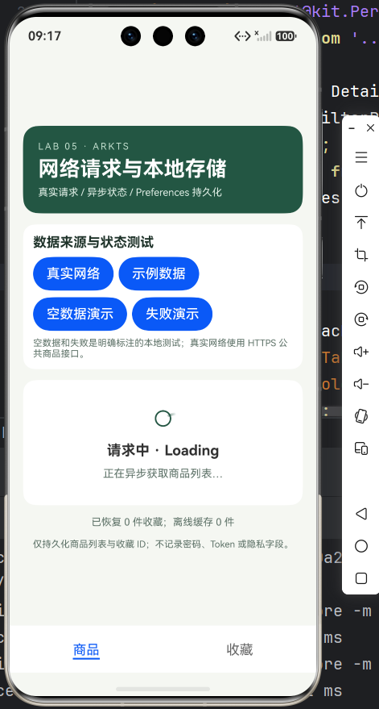
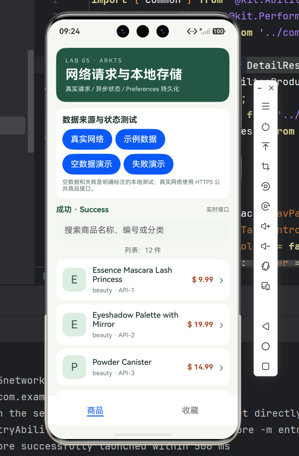
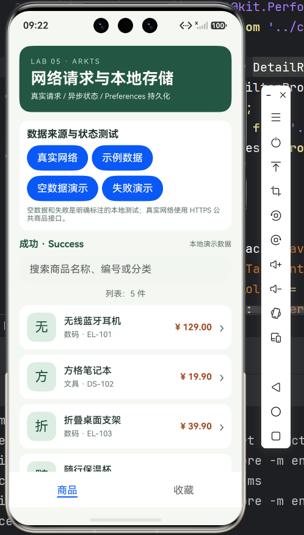
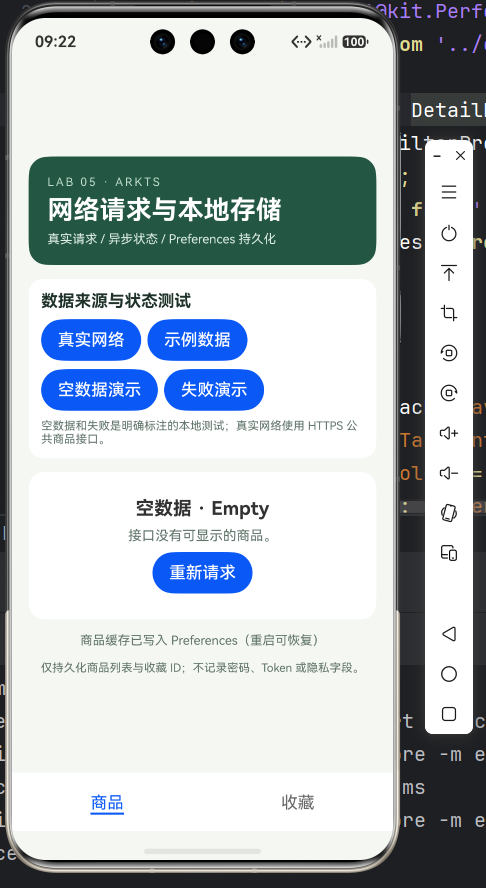
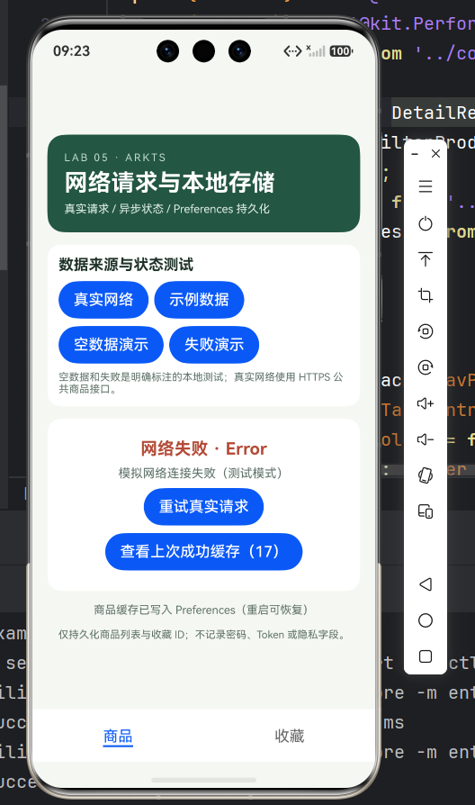
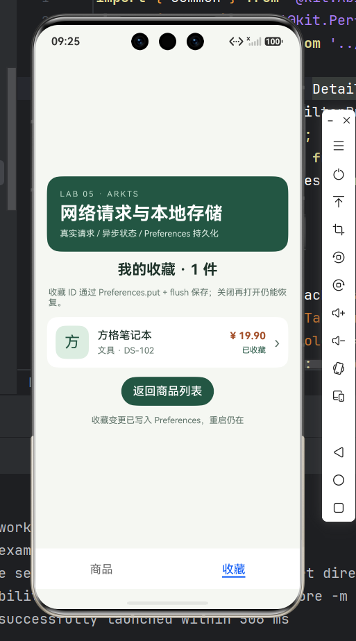
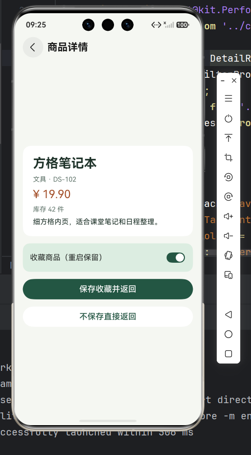

# 移动开发实验五：网络请求与本地存储

基于实验四的商品列表，继续完成网络请求封装、异步加载状态和本地数据保存。项目使用原生 ArkTS / ArkUI，开发环境为 DevEco Studio。

## 主要功能

- **网络请求**：`HttpClient` 统一配置 `baseURL`、连接和读取超时、HTTP 状态检查及异常处理。真实网络模式访问公开商品接口 `https://dummyjson.com/products?limit=12`。
- **异步状态**：商品服务返回 `Promise`，页面用 `async/await` 加载数据，分别显示 Loading、Success、Empty、Error；连续发起请求时忽略过期响应。
- **状态测试**：「示例数据」「空数据演示」「失败演示」用于检查页面状态；模拟失败会明确显示为测试模式，不当作真实网络返回。
- **本地存储**：使用 Preferences 保存商品缓存与收藏 ID，写入后 `flush`，下次启动时恢复数据。
- **页面交互**：支持搜索、商品详情、收藏操作和详情页返回结果。商品详情通过 `NavPathStack` 跳转，底部商品/收藏通过 `TabsController` 切换。
- **数据安全**：本地仅保存公开商品数据和收藏 ID，不存储明文密码、Token 等敏感信息。

## 运行环境

- DevEco Studio 26.0.0
- HarmonyOS 手机模拟器（测试使用 Mate 90 Pro）
- 运行配置：`entry`

在 DevEco Studio 中打开工程根目录，等待工程同步，选择模拟器并运行 `entry`。首次启动加载示例商品；点击「真实网络」可以测试 HTTPS 接口。

## 代码目录

| 位置 | 内容 |
| --- | --- |
| `entry/src/main/ets/service/HttpClient.ets` | HTTP 请求、超时和错误处理 |
| `entry/src/main/ets/service/ProductService.ets` | 商品接口、数据转换及测试模式 |
| `entry/src/main/ets/store/ProductPreferences.ets` | 商品缓存和收藏数据的读写 |
| `entry/src/main/ets/pages/Index.ets` | 列表、搜索、四种状态及收藏页面 |
| `entry/src/main/ets/pages/ProductDetail.ets` | 商品详情与收藏结果返回 |
| `entry/src/main/ets/components/ProductList.ets` | 商品列表组件 |
| `entry/src/main/ets/model/Product.ets` | 商品类型、状态与数据校验 |

## 运行截图

| 场景 | 运行效果 |
| --- | --- |
| 异步加载中 |  |
| 真实网络返回成功 |  |
| 示例商品列表 |  |
| 空数据提示 |  |
| 模拟网络失败与重试入口 |  |
| 收藏商品 |  |
| 商品详情与收藏开关 |  |

## 验证步骤

启动后先检查示例商品列表，再依次使用「真实网络」「空数据演示」「失败演示」观察状态变化。点击商品进入详情，开启收藏并保存返回，切换到底部「收藏」页确认结果。结束应用进程后重新启动，可检查 Preferences 的收藏恢复情况。

真实请求需要模拟器可以访问外部 HTTPS 服务；空数据与失败演示不依赖网络环境。
